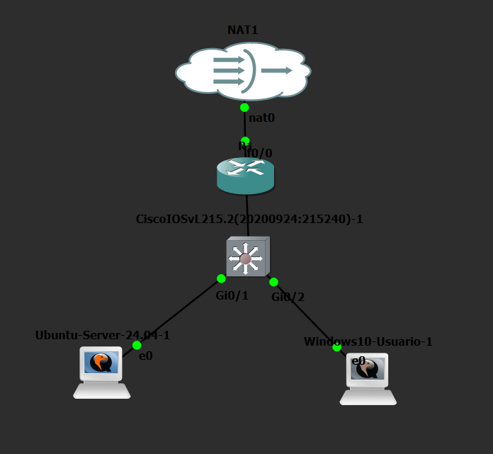

# Laboratorio Zabbix, SNMP y DHCP en GNS3

Laboratorio práctico de **monitoreo y seguridad de red** implementado en GNS3. Se configuró un router Cisco R1 para DHCP y NAT, un switch Cisco SW1 para la conectividad LAN, un servidor Ubuntu con Zabbix y un cliente Windows 10. Zabbix supervisa R1 y SW1 mediante SNMPv2c.

## 🎬 Video demostrativo del laboratorio

> **Enlace de YouTube (pendiente):** [PEGAR AQUÍ EL ENLACE DEL VIDEO](https://www.youtube.com/)
>
> El video mostrará la fecha y hora, la topología en GNS3, las pruebas DHCP y SNMP, el monitoreo en Zabbix y una demostración con cámara y voz. Duración máxima: **10 minutos**.

---

## Objetivos

- Implementar una red funcional en GNS3 con acceso a Internet mediante NAT.
- Configurar DHCP en R1, con asignación dinámica para Windows 10 y reserva de dirección para Ubuntu.
- Habilitar SNMP de solo lectura en R1 y SW1, restringido mediante ACL.
- Registrar y supervisar ambos dispositivos desde la interfaz web de Zabbix.
- Comprobar disponibilidad, datos SNMP, tráfico de interfaces y alertas.

## Topología

**Recorrido:** NAT1 → R1 → SW1 → Ubuntu Server (Zabbix) y Windows 10.

También se incluye un [diagrama adicional](Topologia/Diagrama.png).

## Direccionamiento IPv4

| Dispositivo | Interfaz / función | Dirección | Observación |
|---|---|---|---|
| NAT1 | Gateway de red WAN | `192.168.42.1/24` | Red NAT de GNS3 |
| R1 | Fa0/0, WAN | `192.168.42.184/24` | DHCP desde NAT1; puede variar |
| R1 | Fa0/1, LAN | `10.21.40.1/24` | Gateway LAN y servidor DHCP |
| SW1 | VLAN 1, administración | `10.21.40.2/24` | Gestión y monitoreo SNMP |
| Ubuntu Server | ens3 | `10.21.40.10/24` | Reserva DHCP para Zabbix |
| Windows 10 | Ethernet | `10.21.40.100/24` | Dirección dinámica observada |

**LAN:** `10.21.40.0/24` · **Gateway:** `10.21.40.1` · **DNS:** `8.8.8.8` · **Dominio:** `seguridad.lab`.

El pool `LAN-ZABBIX` excluye `10.21.40.1–99` y `10.21.40.151–254`, dejando `10.21.40.100–150` para clientes dinámicos. El pool independiente `UBUNTU-ZABBIX` reserva `10.21.40.10` para el servidor.

[Ver detalle del direccionamiento](Direccionamiento/README.md).

## Implementación

### Router R1

- Interfaz WAN mediante DHCP y LAN con dirección fija.
- Servicio DHCP para la LAN y reserva para Ubuntu.
- NAT overload hacia la interfaz WAN.
- SNMP de solo lectura restringido por la ACL `ACL-ZABBIX`.

### Switch SW1

- Dirección de administración en VLAN 1.
- Conectividad de R1, Ubuntu y Windows 10.
- SNMP de solo lectura con restricción mediante `ACL-ZABBIX`.

### Ubuntu Server y Zabbix

- Ubuntu Server con dirección `10.21.40.10/24` obtenida mediante reserva DHCP.
- Zabbix 7.4 con MySQL y Apache.
- Hosts **Router R1** (`10.21.40.1`) y **Switch SW1** (`10.21.40.2`) configurados con la plantilla **Cisco IOS by SNMP**, puerto UDP 161.
- Consulta de disponibilidad SNMP, estado de interfaces, recursos y gráficas de tráfico.

La interfaz web del laboratorio se accede localmente mediante `http://10.21.40.10/zabbix` desde la red de pruebas.

## Verificaciones realizadas

| Prueba | Evidencia observada |
|---|---|
| DHCP en R1 | Reserva manual `10.21.40.10` y asignación automática `10.21.40.100` |
| Windows 10 | `ipconfig /all` muestra IP, gateway, DNS y servidor DHCP |
| Conectividad LAN | Ping exitoso desde Windows a R1, SW1 y Ubuntu; 0 % de pérdida |
| Acceso externo | Ping desde Windows a `8.8.8.8`; 0 % de pérdida |
| NAT | `show ip nat statistics` registra traducciones dinámicas activas |
| Control SNMP | ACL permite `10.21.40.10` y deniega otros orígenes |
| Zabbix | Hosts con disponibilidad SNMP, datos recopilados y gráficas de interfaces |
| Alertas | Se observaron advertencias de half-duplex en interfaces de R1; también eventos resueltos |

**Observación:** algunas métricas de la plantilla Cisco IOS figuraban como no soportadas. El monitoreo SNMP y las gráficas documentadas sí funcionaron. Las advertencias se conservan como hallazgos de la práctica.

## Archivos del repositorio

| Carpeta | Contenido |
|---|---|
| [Topologia](Topologia/) | Capturas y diagrama de la red GNS3 |
| [Direccionamiento](Direccionamiento/) | Tabla de IP, subredes, gateway y DHCP |
| [Scripts](Scripts/) | [Comandos de configuración del servidor Ubuntu/Zabbix](Scripts/scripts-servidor-ubuntu-zabbix.txt) |
| [Show running-config](Show%20running-config/) | [Configuración de R1](Show%20running-config/Show%20Running-config%20Router%20R1.txt) y [SW1](Show%20running-config/Show%20Running-config%20Switch%20SW1.txt) |
| [Configuracion Zabbix](Configuracion%20Zabbix/) | [Documento PDF de configuración en la interfaz web](Configuracion%20Zabbix/Configuraci%C3%B3n_Zabbix.pdf) |
| [Evidencias](Evidencias/) | [Informe PDF con pruebas y capturas](Evidencias/Evidencias_Laboratorio_Zabbix.pdf) |

## Consideraciones de seguridad

Las comunidades SNMPv2c funcionan como credenciales compartidas y **no proporcionan cifrado**. En este laboratorio se limitó el acceso mediante una ACL que autoriza al servidor Zabbix (`10.21.40.10`). Para entornos de producción se recomienda SNMPv3 y HTTPS para la interfaz de administración.

Antes de compartir exportaciones de configuración, revisar y ocultar comunidades SNMP, contraseñas y cualquier otro secreto.

## Herramientas utilizadas

GNS3 · Cisco IOS / IOSvL2 · Ubuntu Server 24.04 · Zabbix 7.4 · MySQL · Apache · Windows 10 · SNMPv2c · DHCP · NAT.

---

**Repositorio académico:** prácticas de monitoreo y seguridad de red. Los resultados corresponden a un entorno de laboratorio, no a una red de producción.
